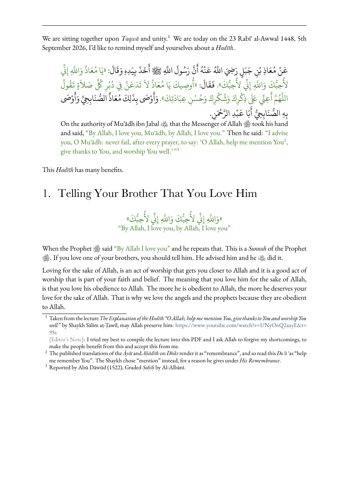
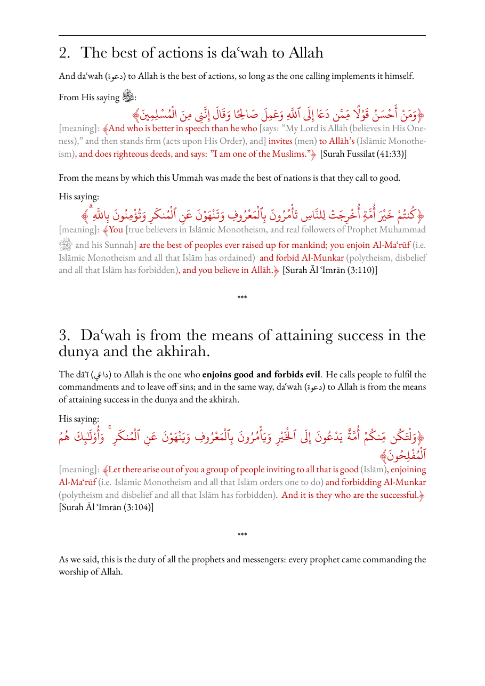

# Islamic Booklet

A LuaLaTeX style for Arabic–English Islamic study material — lesson
notes, booklets, articles and memorisation sheets — with Uthmani script
for the Qurʾān, colour-coded quotations and honorific glyphs.

| | |
|---|---|
|  |  |

[More examples →](docs/examples.md)

## Get started

1. Install **LuaLaTeX**: [MiKTeX](https://miktex.org) (Windows),
   [MacTeX](https://tug.org/mactex/) (Mac) or TeX Live (Linux).
2. Copy a starter from `starters/` into `booklets/my booklet/my booklet.tex`.
3. Build it:

   ```bash
   bash tools/build.sh "my booklet"
   ```

   `PASS` means 0 errors, 0 missing characters and 0 collapsed vowel marks.

## Four shapes

| | |
|---|---|
| `book` | cover, transliteration chart, contents, chapters |
| `article` | running head from page 1, footnote-heavy |
| `faidah` | the notes from one lesson |
| `wtm` | a "what to memorise" sheet |

## Docs

- [**Reference**](docs/reference.md) — options, every macro, the layout extras
- [**Workflow**](docs/workflow.md) — how booklets are made with Claude Code, and its setup
- [**Fonts**](fonts/README.md) — what's included, what to add yourself

## Licence

© 2026 Ariq, under the [LPPL 1.3c](LICENSE). The fonts keep their own
licences.

Page design based on the books typeset by Suheyl bin Munir Mangá, used with his permission.
