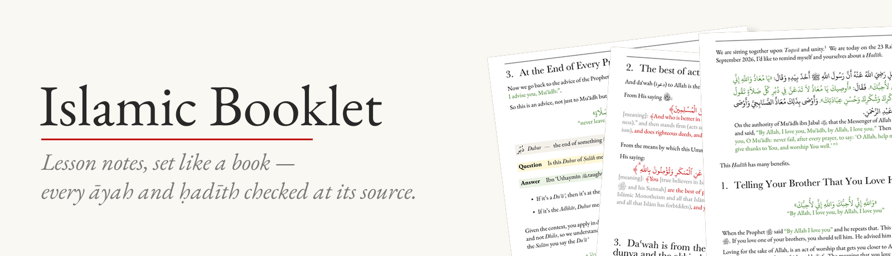
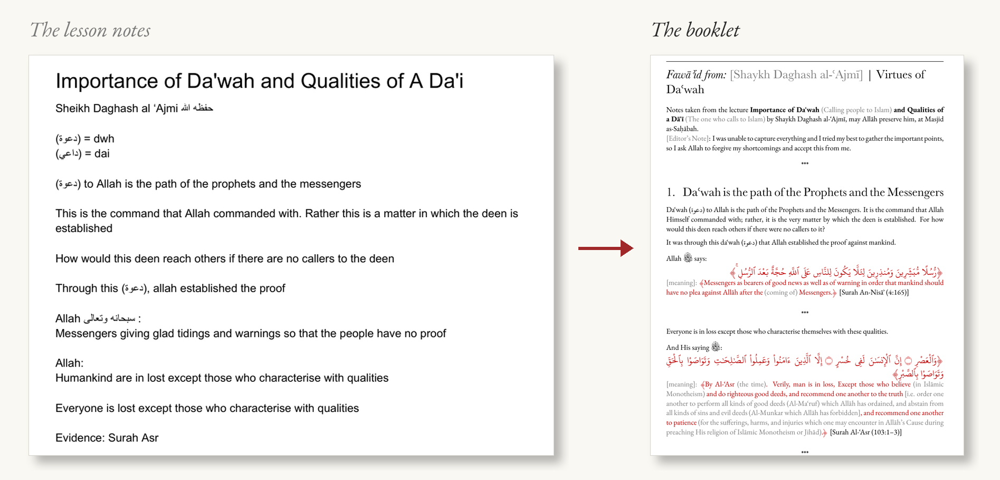
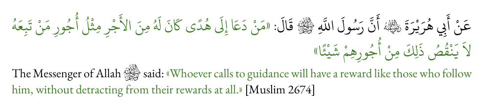
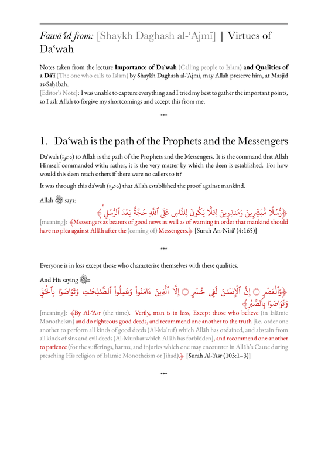

<p align="center">
  
</p>

<p align="center">
  <a href="LICENSE"></a>
  
  
</p>

<p align="center"><i>Lesson notes, set like a book — every āyah and ḥadīth checked at its source.</i></p>

**For** students of knowledge, teachers, and anyone turning lessons into
something worth printing.

## From notes to booklet



- ﷺ **Honorific glyphs**, Uthmani script for the Qurʾān, Arabic and English on one line — no markup
- 🟥 āyāt · 🟩 aḥādīth · 🟦 āthār — **colour-coded**, so a reader always knows what they're reading
- ✅ **Build checks** that catch missing glyphs and broken Arabic vowels before anyone sees the page

## You type this…

```latex
\begin{hadith}
  \ar{\isnad{عَنْ أَبِي هُرَيْرَةَ \ra{} أَنَّ رَسُولَ اللَّهِ \saw{} قَالَ:}
      مَنْ دَعَا إِلَى هُدًى كَانَ لَهُ مِنَ الأَجْرِ مِثْلُ أُجُورِ مَنْ تَبِعَهُ لاَ يَنْقُصُ ذَلِكَ مِنْ أُجُورِهِمْ شَيْئًا}
  \en{\isnad{The Messenger of Allah \saw{} said:} Whoever calls to guidance will have a reward
      like those who follow him, without detracting from their rewards at all.}
  \src{Muslim 2674}
\end{hadith}
```

## …you get this



## Get started

1. Install **LuaLaTeX** — [MiKTeX](https://miktex.org) (Windows),
   [MacTeX](https://tug.org/mactex/) (Mac) or TeX Live (Linux).
2. Copy a starter from `starters/` to `booklets/my booklet/my booklet.tex`.
3. Build:

   ```bash
   bash tools/build.sh "my booklet"
   ```

<details>
<summary><b>The four shapes</b></summary>

| | |
|---|---|
| `book` | cover, transliteration chart, contents, chapters |
| `article` | running head from page 1, footnote-heavy |
| `faidah` | the notes from one lesson |
| `wtm` | a "what to memorise" sheet |

</details>

<details>
<summary><b>See more pages</b></summary>

<p align="center"></p>

</details>

<details>
<summary><b>Making booklets with Claude</b></summary>

Claude Code typesets the notes and checks every āyah, ḥadīth and athar
against quran.com, sunnah.com, dorar.net and Shamela — a person signs off
each one. The skill is in `claude-skill/`; setup and steps are in
[docs/workflow.md](docs/workflow.md).

</details>

## Docs

[Reference](docs/reference.md) · [Workflow](docs/workflow.md) ·
[Fonts](fonts/README.md) · [Examples](docs/examples.md)

---

© 2026 Ariq · [LPPL 1.3c](LICENSE) · fonts keep their own licences.
Page design based on the books typeset by Suheyl bin Munir Mangá, used with his permission.
